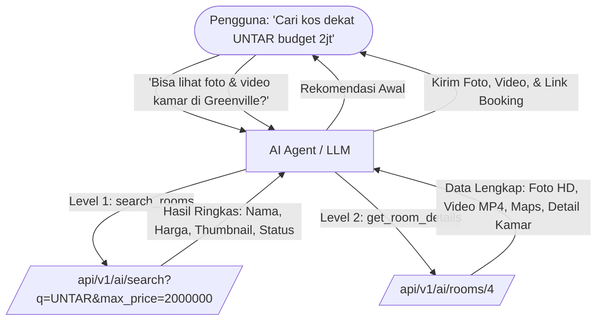

# Highlanderstay AI Room Catalog API Documentation

Dokumentasi resmi REST API untuk integrasi sistem **AI Agent / LLM / Chatbot / RAG / n8n / LangChain / WhatsApp Bot** dengan katalog data kamar, foto, video, harga, dan lokasi Highlanderstay.

---

## 1. Arsitektur 2-Level Data Retrieval

Data kamar di Highlanderstay sangat banyak dan dinamis. Jika seluruh detail kamar dan media (foto/video) dimasukkan sekaligus ke dalam prompt AI, hal tersebut akan:
1. **Memboroskan token context window** (biaya LLM tinggi).
2. **Membuat respon AI lambat** (latency tinggi).
3. **Meningkatkan risiko halusinasi data**.

Oleh karena itu, API ini dirancang dengan **2-Level Architecture**:



---

## 2. Base URL Endpoints

| Lingkungan | Base URL (Direct Backend Laravel) | Base URL (Frontend Proxy) |
| :--- | :--- | :--- |
| **Production** | `https://dashboard.highlanderstay.com/api/v1/ai` | `https://highlanderstay.com/api/ai` |
| **Local Dev** | `http://localhost:8000/api/v1/ai` | `http://localhost:5000/api/ai` |

---

## 3. Level 1: Endpoint Pencarian Ringkas (`search_rooms`)

Endpoint ini digunakan oleh AI untuk menyaring dan mencari rekomendasi kamar berdasarkan kriteria pengguna.

- **Method**: `GET`
- **URL**: `/api/v1/ai/search` (alias: `/api/v1/ai/rooms`)
- **Headers**: `Accept: application/json`

### Query Parameters

| Parameter | Tipe | Default | Contoh | Keterangan |
| :--- | :--- | :--- | :--- | :--- |
| `q` | string | `null` | `untar`, `kemayoran` | Kata kunci nama properti, kampus, atau mall |
| `location` / `area` | string | `null` | `Kebon Jeruk`, `Grogol` | Filter nama kecamatan atau area kota |
| `min_price` | number | `null` | `1500000` | Filter batas harga sewa minimum bulanan (IDR) |
| `max_price` | number | `null` | `2500000` | Filter batas harga sewa maksimum bulanan (IDR) |
| `only_available` | boolean | `true` | `true` / `false` | `true` = hanya unit dengan kamar kosong siap huni |
| `type` | string | `all` | `kos`, `apartment` | Filter tipe properti |
| `limit` | integer | `10` | `5` | Jumlah maksimal data yang dikembalikan (maks: 50) |
| `offset` | integer | `0` | `10` | Offset paginasi hasil |

### Contoh Request (cURL)

```bash
curl -X GET "https://dashboard.highlanderstay.com/api/v1/ai/search?location=Kebon%20Jeruk&max_price=2500000&limit=3" \
  -H "Accept: application/json"
```

### Contoh Response (`200 OK`)

```json
{
  "success": true,
  "total_found": 3,
  "returned": 3,
  "limit": 3,
  "offset": 0,
  "query_params": {
    "q": null,
    "location": "Kebon Jeruk",
    "min_price": null,
    "max_price": 2500000,
    "only_available": true,
    "type": "all"
  },
  "data": [
    {
      "id": 4,
      "name": "GREENVILLE",
      "slug": "mangga",
      "type": "kos",
      "category": "Premium Boarding Room",
      "area": "Kebon Jeruk",
      "address": "JL.Mangga 2 Blok B No.34 RT.008/08 Kel.Duri Kepa Kec.Kebon Jeruk, Jakbar",
      "price_display": "Rp 2.000.000/bulan",
      "min_price_numeric": 2000000,
      "available_rooms_count": 1,
      "availability_status": "Ready 1 kamar",
      "thumbnail_url": "https://dashboard.highlanderstay.com/storage/properties/9DpfehjKMHyZELFlu5N9dJ2FjgZp6U0EjiAO6AFD.jpg",
      "video_url": "https://dashboard.highlanderstay.com/storage/properties/videos/MPNwsUFLPur6LeMQEaGUDYSiRzH0rJpQ0zMogbOB.mp4",
      "google_maps_url": "https://maps.app.goo.gl/jJhUASZEtzvJyvQT8",
      "booking_url": "https://highlanderstay.com/property/4-mangga",
      "keeper_contact": "+628211065298",
      "detail_api_url": "https://dashboard.highlanderstay.com/api/v1/ai/rooms/4"
    }
  ]
}
```

```

---

## 4. Endpoint Ringkasan Wilayah & Lokasi (`get_available_locations`)

Endpoint ini dirancang khusus untuk pertanyaan awal percakapan pengguna, seperti:
> *"Kak, kos Highlanderstay ada di lokasi mana saja?"*  
> *"Mau cari kamar kosong, lokasinya di daerah mana aja ya?"*

Dengan memanggil endpoint ini, AI langsung mendapatkan rekapitulasi seluruh area properti, jumlah kamar kosong di setiap area, harga termurah, serta kalimat ringkasan (`ai_summary_text`) yang bisa langsung dibacakan ke pengguna.

- **Method**: `GET`
- **URL**: `/api/v1/ai/locations` (alias: `/api/v1/ai/areas`)
- **Headers**: `Accept: application/json`

### Parameter Query (Opsional)

| Parameter | Tipe | Default | Keterangan |
|---|---|---|---|
| `only_available` | `boolean` | `false` | Jika `true` / `1`, hanya mengembalikan wilayah yang memiliki kamar kosong tersedia (`total_available_rooms > 0`). |
| `type` | `string` | `all` | Filter tipe properti: `all`, `kos`, atau `apartment`. |
| `city` | `string` | - | Filter nama kota (contoh: `Jakarta`, `Tangerang`, `Palembang`). |

### Contoh Request (cURL)

```bash
# Ambil hanya lokasi yang memiliki kamar kosong ready
curl -X GET "https://dashboard.highlanderstay.com/api/v1/ai/locations?only_available=true" \
  -H "Accept: application/json"
```

### Contoh Response (`200 OK`)

```json
{
  "success": true,
  "total_active_properties": 15,
  "total_available_rooms": 9,
  "available_areas_with_vacant_rooms": [
    "Grogol",
    "Kebon Jeruk",
    "Kemayoran",
    "Cengkareng",
    "Tangerang"
  ],
  "all_coverage_areas": [
    "Grogol",
    "Kebon Jeruk",
    "Kemayoran",
    "Cengkareng",
    "Tangerang",
    "Palembang"
  ],
  "ai_answer_suggestion": "Saat ini Highlanderstay menyediakan kamar kosong di area: Grogol (3 kamar ready, mulai Rp 1.400.000/bulan), Kebon Jeruk (2 kamar ready, mulai Rp 2.000.000/bulan), Kemayoran (2 kamar ready, mulai Rp 1.800.000/bulan), Tangerang (1 kamar ready, mulai Rp 1.300.000/bulan). Kakak berminat cari kamar di area mana atau dekat kampus/kantor apa?",
  "ai_summary_text": "Cakupan wilayah Highlanderstay: Grogol (2 properti, 3 kamar ready, mulai Rp 1.400.000/bulan); Kebon Jeruk (5 properti, 2 kamar ready, mulai Rp 2.000.000/bulan); ...",
  "areas": [
    {
      "area": "Grogol",
      "city": "Jakarta Barat",
      "total_properties": 2,
      "total_available_rooms": 3,
      "min_price_numeric": 1400000,
      "price_starts_from": "Rp 1.400.000/bulan",
      "properties": [
        {
          "id": 1,
          "name": "Alpukat",
          "slug": "alpukat",
          "type": "kos",
          "available_rooms_count": 2,
          "status": "Ready 2 kamar",
          "price_display": "Rp 1.400.000/bulan",
          "booking_url": "https://highlanderstay.com/property/1-alpukat"
        }
      ]
    },
    {
      "area": "Kebon Jeruk",
      "city": "Jakarta Barat",
      "total_properties": 5,
      "total_available_rooms": 2,
      "min_price_numeric": 2000000,
      "price_starts_from": "Rp 2.000.000/bulan",
      "properties": [
        {
          "id": 4,
          "name": "GREENVILLE",
          "slug": "mangga",
          "type": "kos",
          "available_rooms_count": 1,
          "status": "Ready 1 kamar",
          "price_display": "Rp 2.000.000/bulan",
          "booking_url": "https://highlanderstay.com/property/4-mangga"
        }
      ]
    }
  ]
}
```

---

## 5. Level 2: Endpoint Detail Lengkap Properti & Kamar (`get_room_details`)

Endpoint ini dipanggil ketika AI membutuhkan media lengkap (foto HD, video tur, alamat rute, rincian tiap nomor kamar, lantai, dan fasilitas).

- **Method**: `GET`
- **URL**: `/api/v1/ai/rooms/{id}` (atau `/api/v1/ai/properties/{id}`)
- **Path Parameter**: `{id}` = ID numerik (contoh: `4`) atau slug properti (contoh: `mangga`).
- **Headers**: `Accept: application/json`

### Contoh Request (cURL)

```bash
curl -X GET "https://dashboard.highlanderstay.com/api/v1/ai/rooms/4" \
  -H "Accept: application/json"
```

### Contoh Response (`200 OK`)

```json
{
  "success": true,
  "data": {
    "id": 4,
    "name": "GREENVILLE",
    "slug": "mangga",
    "type": "kos",
    "category": "Premium Boarding Room",
    "description": "AC, WiFi, kasur, lemari, meja, kamar mandi",
    "address": "JL.Mangga 2 Blok B No.34 RT.008/08 Kel.Duri Kepa Kec.Kebon Jeruk, Jakbar",
    "area": "Kebon Jeruk",
    "coordinates": {
      "latitude": -6.1742293,
      "longitude": 106.7781881
    },
    "google_maps_url": "https://maps.app.goo.gl/jJhUASZEtzvJyvQT8",
    "price_display": "Rp 2.000.000/bulan",
    "min_monthly_price": 2000000,
    "deposit_amount": 500000,
    "deposit_display": "Rp 500.000",
    "availability_status": "Ready 1 kamar",
    "available_rooms_count": 1,
    "keeper_phone": "+628211065298",
    "keeper_whatsapp_url": "https://wa.me/628211065298",
    "booking_url": "https://highlanderstay.com/property/4-mangga",
    "facilities": [
      "AC Dingin",
      "WiFi Fiber Cepat",
      "Kamar Mandi Dalam",
      "Kasur Springbed & Lemari Pakaian",
      "Parkir Motor / Mobil",
      "Air & Listrik Terjamin"
    ],
    "media": {
      "photos": [
        "https://dashboard.highlanderstay.com/storage/properties/wn7vq9Mw9aSPBCgA0XNmDRvjFm0PoGFN1VawXwFO.jpg",
        "https://dashboard.highlanderstay.com/storage/properties/DP5VyIiMaNqNyJJPo4WhzKVOXHd1URYCtWBjd44b.jpg"
      ],
      "video_tour": "https://dashboard.highlanderstay.com/storage/properties/videos/MPNwsUFLPur6LeMQEaGUDYSiRzH0rJpQ0zMogbOB.mp4"
    },
    "available_rooms": [
      {
        "room_id": 151,
        "name": "Kamar 301",
        "floor": "Lantai 3",
        "size_sqm": null,
        "bathroom": "Kamar Mandi Dalam",
        "monthly_rate": 2000000,
        "monthly_rate_display": "Rp 2.000.000 / bulan",
        "photo_url": "https://dashboard.highlanderstay.com/storage/properties/wn7vq9Mw9aSPBCgA0XNmDRvjFm0PoGFN1VawXwFO.jpg",
        "video_url": "https://dashboard.highlanderstay.com/storage/properties/videos/MPNwsUFLPur6LeMQEaGUDYSiRzH0rJpQ0zMogbOB.mp4"
      }
    ]
  }
}
```

---

## 5. Level 3: Function Calling Schema (`/api/v1/ai/schema`)

Endpoint ini menyediakan JSON schema function calling standar OpenAPI yang bisa langsung digunakan oleh **OpenAI (GPT-4o)**, **Google Gemini**, **LangChain**, maupun **n8n AI Agent**.

- **URL**: `GET /api/v1/ai/schema`

### Contoh Skema JSON (Siap Pakai untuk OpenAI / LangChain):

```json
[
  {
    "type": "function",
    "function": {
      "name": "search_rooms",
      "description": "Mencari dan memfilter kamar kos/apartemen Highlanderstay berdasarkan lokasi/kampus, rentang harga, atau kata kunci.",
      "parameters": {
        "type": "object",
        "properties": {
          "q": {
            "type": "string",
            "description": "Kata kunci pencarian (nama kos, kampus seperti UNTAR / Trisakti / Binus, atau nama mall)"
          },
          "location": {
            "type": "string",
            "description": "Nama wilayah atau kecamatan (contoh: Kebon Jeruk, Grogol, Kemayoran, Tangerang, Palembang)"
          },
          "min_price": {
            "type": "number",
            "description": "Harga sewa minimum bulanan dalam Rupiah (contoh: 1500000)"
          },
          "max_price": {
            "type": "number",
            "description": "Harga sewa maksimum bulanan dalam Rupiah (contoh: 3000000)"
          },
          "only_available": {
            "type": "boolean",
            "description": "Hanya tampilkan unit yang masih memiliki kamar kosong (default: true)"
          },
          "type": {
            "type": "string",
            "enum": ["all", "kos", "apartment"],
            "description": "Tipe akomodasi: 'kos' atau 'apartment'"
          },
          "limit": {
            "type": "integer",
            "description": "Jumlah rekomendasi (default: 5)"
          }
        }
      }
    }
  },
  {
    "type": "function",
    "function": {
      "name": "get_room_details",
      "description": "Mengambil informasi lengkap properti dan kamar (semua foto HD, link video walkthrough, rute Google Maps, fasilitas, dan detail tipe kamar).",
      "parameters": {
        "type": "object",
        "properties": {
          "id": {
            "type": "string",
            "description": "ID properti atau slug properti dari hasil search_rooms (contoh: '4' atau 'mangga')"
          }
        },
        "required": ["id"]
      }
    }
  }
]
```

---

## 6. Contoh Implementasi Kode (Python / LangChain / OpenAI)

Berikut adalah contoh bagaimana menghubungkan API ini ke script AI berbasis Python:

```python
import os
import requests
from openai import OpenAI

client = OpenAI(api_key=os.environ.get("OPENAI_API_KEY"))

BASE_API_URL = "https://dashboard.highlanderstay.com/api/v1/ai"

def search_rooms(q=None, location=None, max_price=None, min_price=None, limit=5):
    params = {
        "q": q,
        "location": location,
        "max_price": max_price,
        "min_price": min_price,
        "limit": limit,
        "only_available": "true"
    }
    # Hapus parameter yang bernilai None
    params = {k: v for k, v in params.items() if v is not None}
    res = requests.get(f"{BASE_API_URL}/search", params=params)
    return res.json().get("data", [])

def get_room_details(room_id):
    res = requests.get(f"{BASE_API_URL}/rooms/{room_id}")
    return res.json().get("data", {})

# Contoh eksekusi AI Tool:
# 1. User bertanya: "Ada kos dekat untar di bawah 2 juta yang kamarnya ada video turnya?"
hasil_cari = search_rooms(q="untar", max_price=2000000, limit=3)
print("Hasil pencarian ringkas:", hasil_cari)

if hasil_cari:
    first_id = hasil_cari[0]["id"]
    detail = get_room_details(first_id)
    print("Detail lengkap unit:", detail["name"])
    print("Video Tour:", detail["media"]["video_tour"])
    print("Foto Kamar:", detail["media"]["photos"])
```

---

## 7. Integrasi dengan n8n (WhatsApp / Telegram Bot)

Jika menggunakan **n8n AI Agent Workflow**:
1. Pasang node **AI Agent** (Tools Agent).
2. Tambahkan node **HTTP Request Tool** (Name: `search_rooms`):
   - Method: `GET`
   - URL: `https://dashboard.highlanderstay.com/api/v1/ai/search`
   - Query Parameters: `location={{ $fromAI('location') }}`, `max_price={{ $fromAI('max_price') }}`, `q={{ $fromAI('q') }}`
3. Tambahkan node **HTTP Request Tool** kedua (Name: `get_room_details`):
   - Method: `GET`
   - URL: `https://dashboard.highlanderstay.com/api/v1/ai/rooms/{{ $fromAI('id') }}`
4. Saat user di WhatsApp bertanya, n8n otomatis memanggil API tersebut dan mengirimkan foto/video kamar langsung ke WhatsApp pengguna!
